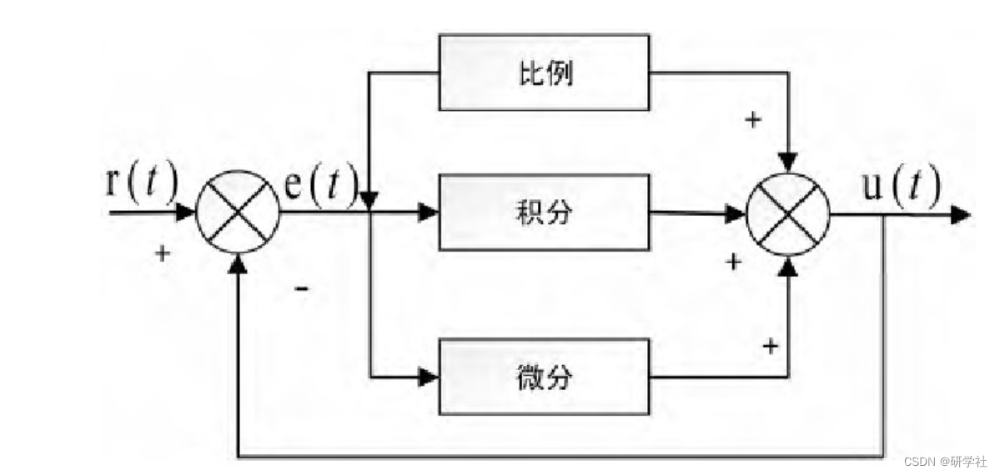
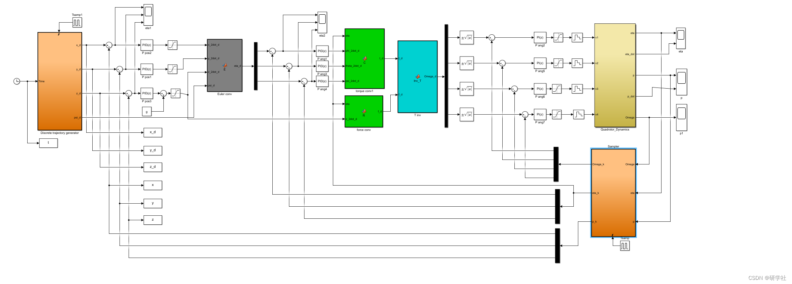
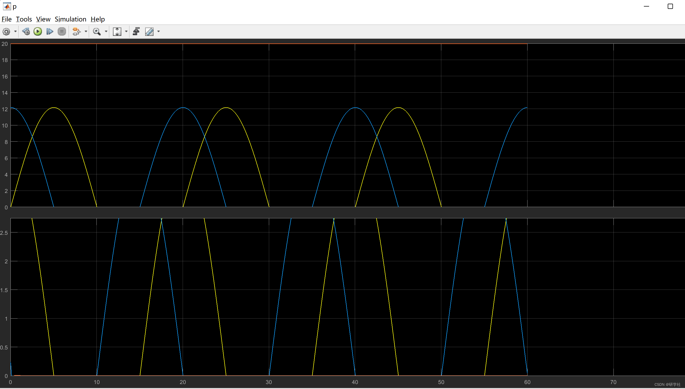
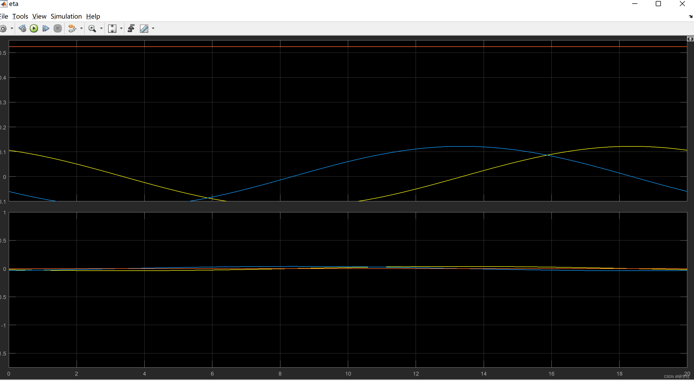
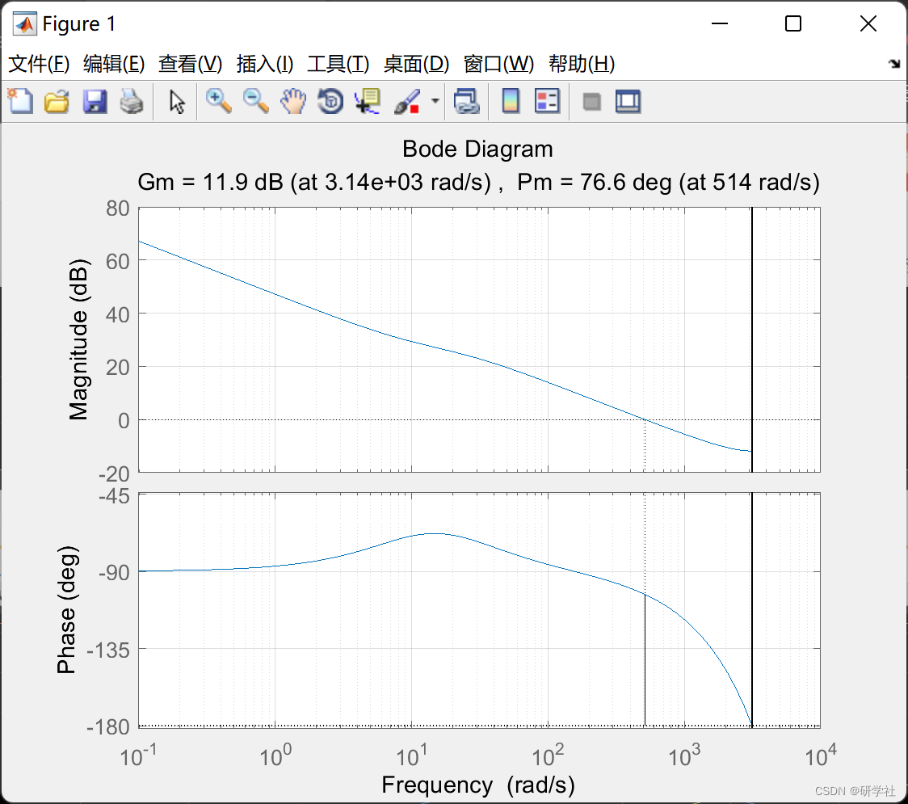
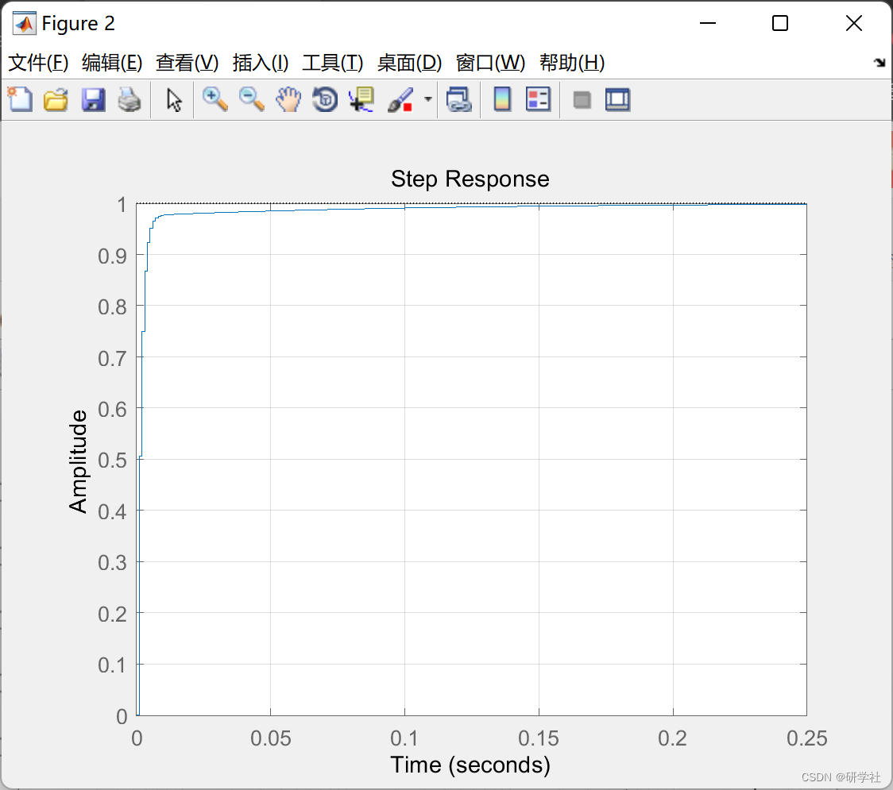

# Simulation of Quadcopter Vehicle Based on PID Control (Matlab Code Implementation)

💥💥💞💞 Welcome to this blog❤️❤️💥💥
🏆 Bloggers' Advantages: 🌞🌞🌞 The content of the blog strives for rigorous thinking and clear logic to facilitate readers.
⛳️ Mantra: A journey of a thousand miles is begun by taking the first step. 1 Overview📚2 Running Results🎉3 References🌈4 MATLAB Code Implementation
💥1 Overview In recent years, with the continuous development of technology, various sensor and communication technologies have been breaking through, and unmanned aerial vehicle (UAV) technology has developed rapidly. It has played an important role in various application fields such as military reconnaissance, traffic patrolling, scenic aerial photography, and high-altitude cable inspection. Quadcopters, due to their operational flexibility, small terrain restrictions, convenient carrying, and low cost, are more closely integrated into our daily lives. Therefore, researching UAVs holds significant academic value and significance.
Traditional PID consists of three parts: proportional, integral, and derivative, which can achieve different control effects as shown in the figure. The core of the PID control algorithm is to eliminate the deviation using the error, which can effectively estimate the control system:
Edit
📚2 Running Results
Edit
Edit
Edit
Edit
Part of the code:
I = [Ixx 0 0;0 Iyy 0;0 0 Izz];
Jtp = 104e-6;
Ke = 6.3e-3;
Km = 6.3e-3;
L = 15e-6;
b = 54.2e-6;
l = 0.24;
g = 9.81;
n = 0.9;
N = 5.6;
h = 1e-3;
R = 0.6;
d = 1.1e-6; % drag factor
% Motor Controller Design
Kp_position = 5;
Ki_position = 0;
Kd_position = 10;  
Kp_angle = 5*2;  
Ki_angle = 0;  
Kd_angle = 10*2;  
Kp_motor = 1;  
Ki_motor = 10;  
Kd_motor = 0;  
%w'=Apw+Bpv+Cp  
Ap = -22.5;  
Bp = 509;  
Cp = 489;  
a1 = Ap;  
b1 = Bp;  
c1 = 1;  
d1 = 0;  
sys_c_m = ss(a1,b1,c1,d1);  
Gc_m = tf(sys_c_m);  
sys_d_m = c2d(sys_c_m,h,'zoh');  
Gd_m = tf(sys_d_m);  
Cc_m = tf([Kp_motor Ki_motor],[1 0]);  
sys_c_mctrl = ss(Cc_m);  
sys_d_mctrl = c2d(sys_c_mctrl,h,'tustin');  
Cd_m = tf(sys_d_mctrl);  
LGd_m = Gd_m*Cd_m;  
Td_m = feedback(LGd_m,1);  
figure(1)  
margin(LGd_m)  
hold on  
grid on  
figure(2)  
step(Td_m)  
hold on  
grid on  
num = [1];  
den = [1 0 0];  
Gc_p = tf(num,den);  
sys_c_p = ss(Gc_p);  
sys_d_p = c2d(sys_c_p,h,'zoh');  
Gd_p = tf(sys_d_p);  
🎉3 References  
[2] Wang Zhendong, Zhang Yan. Prediction of Quadrotor UAV - PID Composite Control Research [J]. Control Engineering, 2021, 28(07):1390-1397. DOI:10.14107/j.cnki.kzgc.20190156.  
[3] Li Guohong, Wei Pengfei, Gao Ran. Particle Swarm Control Based on Quadrotor UAV [J]. Industrial Control Computer, 2022, 35(02):102-104.  
🌈4 MATLAB Code Implementation

## Images

<!-- PAYMENT_BLOCK -->

## Get this dataset

- Payment link (Stripe): [Buy now](https://buy.stripe.com/3cs8yP7sY87d0vu9AB)
- Payment QR code: 

<!-- /PAYMENT_BLOCK -->
